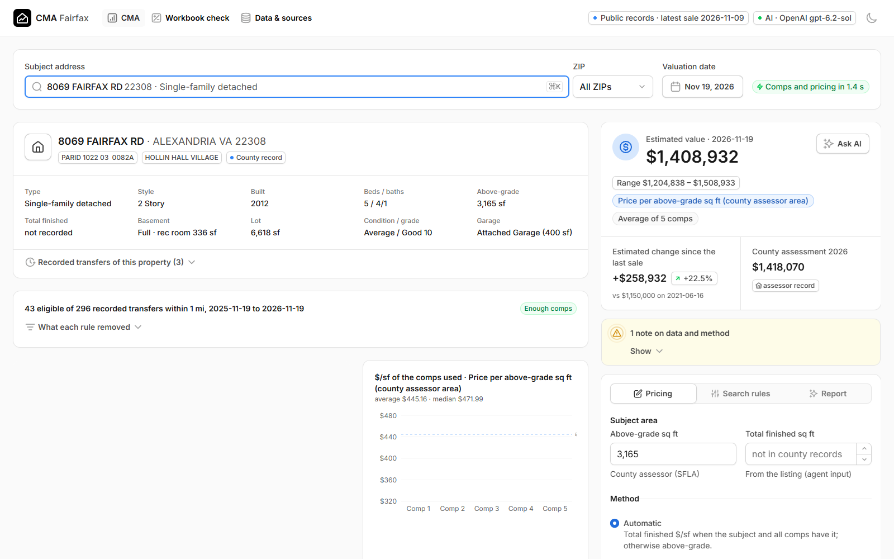

# CMA

A comparative market analysis web app for a real estate team. Pick a property by subdivision, block and street, and the app:
- finds recorded comparable sales on or before the valuation date
- ranks them by similarity, with no regard to price
- prices the subject with the team's workbook method (price per sq ft)
- exports a branded PDF or Excel report (the Excel report follows the team's CMA workbook layout)

Data comes from **Fairfax County public records** (Department of Tax Administration and the Master Address
Repository, published on ArcGIS Online). It is not MLS data. The data layer is pluggable, so an approved MLS feed
or another licensed provider can be added later.



## Quick start (Windows, PowerShell)

Requires Python 3.12+ and Node 20+.

```powershell
scripts\setup.ps1     # venv, Python + npm packages, .env, migrations, frontend build
scripts\refresh.ps1   # first data import for 22308 + 22309 (about 4–5 minutes; safe to re-run)
scripts\run.ps1       # http://127.0.0.1:8000
```

The same steps by hand:

```powershell
cd backend
python -m venv .venv
.venv\Scripts\pip install -r requirements-dev.txt
copy ..\.env.example ..\.env
.venv\Scripts\python -m alembic upgrade head
.venv\Scripts\python -m app.ingest.refresh            # or: --zips 22308
cd ..\frontend; npm ci; npm run build; cd ..\backend
.venv\Scripts\python -m uvicorn app.main:app --port 8000
```

For development with hot reload, run `scripts\dev.ps1`. It starts the API on :8000 and the Next.js dev server on
http://127.0.0.1:3000, which proxies `/api` to the API.

To enable the AI assistant:
1. Paste the OpenAI key into `.env` as `OPENAI_API_KEY=...`.
2. Restart `scripts\run.ps1`.
3. Run `scripts\check-ai.ps1` to confirm the key and model work.

The key stays on the server and is never sent to the browser. Everything else works without it.

## Using it

1. **CMA** page: choose a **Subdivision**, **Block** and/or **Street** (each narrows the next; Ctrl+K focuses the
   first box), then pick the **Property**, or click one of the example buttons. Blocks come from the county legal
   description ("LT 21 BLK A"), so subdivisions without platted blocks show none. Set the valuation date with the calendar. Comps and pricing appear in about 1–3 s.
   - **Selling or building a different house than the county record?** Click "Describe house to sell / build" on the
     subject card and enter the planned property type, beds, baths, sq ft, year built, style, condition and basement.
     Comps are then ranked and priced against the planned house; reports label those values as agent input.
   - **Comps from**: within the radius (default 1 mi), the subject's **same subdivision** (community), or its **same
     block**. Shown on the search summary and under "Search rules".
2. Review the comps:
   - the map, the $/sf chart and the table are linked: click a marker or a bar to highlight the table row
   - each comp has a score bar and a reason; the arrow opens a side panel with the factor breakdown and the county
     record
   - include or exclude any comp with the checkbox
   - "Search rules" changes the radius, look-back, size tolerance, accepted county validity codes and ranking weights
     (sliders)
3. **Pricing**:
   - enter total finished sq ft for the subject and comps (from the listing) to use the workbook's total-finished calculation
   - add adjustments (for example a garage or ADU) and set appreciation
   - average or median $/sf
4. **Report**:
   - draft the narrative (AI or template) and edit it
   - set branding
   - preview, then export PDF or Excel
   - the export refuses if the figures changed since review
5. **Ask AI** (button on the estimate card; needs `OPENAI_API_KEY`): a side panel chat. The assistant reads the computed
   facts, comps and valuation through tools, cites records, and explains them. It cannot change the numbers.
6. **Workbook check**: reproduces the client workbook's "1009 New" = $3,190,926.67, shows the recalculated figures,
   and lists the issues found. The **Subject** can also be set to any address in 22308/22309, and the choice is saved
   for the whole team. The page then shows the workbook formula applied to that house next to a live Fairfax CMA for
   it.
7. **Data & sources**: last refresh, datasets, terms, and which workbook fields come from where.

## How it works

In short:
1. **Import.** `refresh` pulls the county's public records (addresses, parcels, houses, recorded sales) for 22308 and
   22309 into the database. Duplicates are collapsed, nothing is deleted, and every row keeps its source record ID.
2. **Find comps.** For the chosen address and valuation date, the backend keeps only sales on or before that date
   that pass the rules (radius, look-back, validity, size, type). It then ranks them by similarity: distance, recency,
   size, beds, baths, lot, age, style, condition and features. Price is never used to rank.
3. **Price.** The top 5 comps' price per square foot (average or median) is multiplied by the subject's area, using
   the workbook method. Adjustments and appreciation are optional and shown as separate lines. Above-grade and total
   finished area are never mixed.
4. **Review and export.** The agent reviews comps on the map and in the table, edits inputs, and exports a branded PDF
   or Excel report. Export is refused if the figures changed since the agent last reviewed them.
5. **AI (optional).** OpenAI reads the computed results through tools to explain them and draft the narrative. It
   cites records and cannot change the numbers. Without a key, a template narrative is used.

```
frontend/ (Next.js 16 static export + Untitled UI React components + Leaflet)
    src/app/                  routes: / (CMA), /workbook, /data
    src/components/cma/       the CMA screens (search, map, comp table, pricing, rules, report, AI chat)
    src/components/{base,application,foundations,...}   Untitled UI React component library (from react-pro-components-main)
    src/providers/cma-provider.tsx   CMA state shared across pages
    │  /api  (same origin: FastAPI serves frontend/out)
backend/app/
    sources/      provider interface; fairfax_arcgis.py (paging, batching, retries)
    ingest/       repeatable refresh: idempotent upserts, never deletes sales, change history
    comps/        eligibility funnel + price-blind weighted ranking with reasons
    valuation/    workbook $/sf method (two separate area calculations) + workbook regression
    services.py   one run_cma() used by the API, reports and AI agent, so every surface shows the same figures
    reports/      one report model → PDF (reportlab) and Excel (XlsxWriter, workbook layout with live formulas); local location diagram
    agent/        AI tool loop over the computed CMA: OpenAI (default) or Anthropic; template narrative fallback
    api/          FastAPI routes
alembic/          migrations
```

The production frontend is a static export: `npm run build` writes `frontend/out`, and FastAPI serves it next to
`/api`. The whole app therefore runs as one server process, and provider keys stay on the server. The previous Vite
frontend is kept in `_archive/frontend-vite` for reference.

- **Database:** SQLite by default (zero setup). Set `DATABASE_URL=postgresql+psycopg://…` for PostgreSQL/PostGIS. The
  same migrations apply. Distance is computed in Python after a bounding-box query, so PostGIS functions are optional.
- **Traceability:** every row keeps the provider, dataset, source record ID (OBJECTID; deed book/page; SITE_ADDRESS_ID),
  raw payload and retrieval time. Reports list the record behind the subject and every comp.

## Configuration (`.env`)

See [`.env.example`](.env.example). The main settings are:
- `DATABASE_URL`
- `TARGET_ZIPS` (default `22308,22309`)
- `DATA_PROVIDER`
- `ARCGIS_TOKEN` (not needed for the public layers)
- `AI_PROVIDER` (`auto`, `openai`, `anthropic` or `none`)
- `OPENAI_API_KEY`, `OPENAI_MODEL` (default `gpt-6.2-sol`), `OPENAI_REASONING_EFFORT` (blank uses the model's default)
- `ANTHROPIC_API_KEY`, `ANTHROPIC_MODEL` (optional alternative provider)
- `BRAND_*` defaults (branding is also editable and saved in the app)
- `APP_USERNAME` / `APP_PASSWORD`: a shared login (HTTP Basic) for the whole app. **Set it on any server others can reach.**

## Data refresh

```powershell
scripts\refresh.ps1                  # all TARGET_ZIPS
scripts\refresh.ps1 --zips 22309     # one ZIP
```

- The county updates its extract daily. Schedule the refresh with Windows Task Scheduler or cron, or the compose
  `refresh` profile.
- Re-runs only update what changed.
- Sales missing from a later extract are kept and flagged.
- Changes are kept in `source_record_history`.

## Tests

```powershell
scripts\test.ps1               # 43 offline tests (scripted AI clients; never calls a real AI provider)
scripts\test.ps1 -Live         # + 9 read-only checks against the county services
scripts\test.ps1 -Browser      # + timed browser workflow in both ZIPs (uses installed Edge)
scripts\check-ai.ps1           # one real AI call to confirm the key and model (uses the key in .env)
python scripts\timing.py       # API turnaround for real addresses
python scripts\spot_check.py "8069 fairfax rd" 22308   # compare a CMA with the live county records
```

Results are in [docs/TEST_RESULTS.md](docs/TEST_RESULTS.md).

## Deployment

- **Docker** (Linux host): run `./scripts/deploy.sh`. It builds the image (React build plus the API), starts PostGIS and
  the app, runs migrations on start, and loads data. Re-run the refresh daily:
  `docker compose --profile refresh run --rm refresh`.
- **CI:** [`.github/workflows/ci.yml`](.github/workflows/ci.yml) runs:
  - backend tests on SQLite and on PostgreSQL/PostGIS
  - live county checks (informational)
  - the frontend build
  - a Docker build
- **Single machine without Docker:** run `scripts\setup.ps1`, `scripts\refresh.ps1` and `scripts\run.ps1`, behind any
  reverse proxy.

## Documents

| Document | Contents |
|---|---|
| [docs/DATA_VERIFICATION.md](docs/DATA_VERIFICATION.md) | Live-service checks, joins, parcel-ID format, paging, duplicates, validity codes, missing fields, sq ft definitions, field availability, data terms |
| [docs/WORKBOOK_ANALYSIS.md](docs/WORKBOOK_ANALYSIS.md) | Formula trace, "1009 New" regression, app-selected comparison, every workbook issue |
| [docs/WORKED_EXAMPLE.md](docs/WORKED_EXAMPLE.md) | Full CMA for 8069 Fairfax Rd (22308), with records and timings; 22309 and three-comp examples |
| [docs/TEST_RESULTS.md](docs/TEST_RESULTS.md) | Test suites, edge cases, timings, what is not yet verified |
| [docs/CLIENT_DECISIONS.md](docs/CLIENT_DECISIONS.md) | Decisions that need the client |
| [docs/examples/](docs/examples/) | Sample PDF and Word reports |
